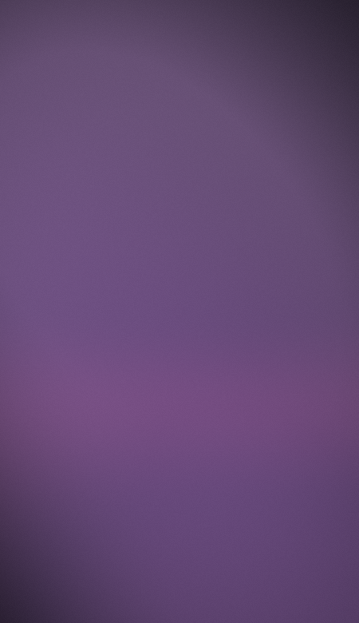
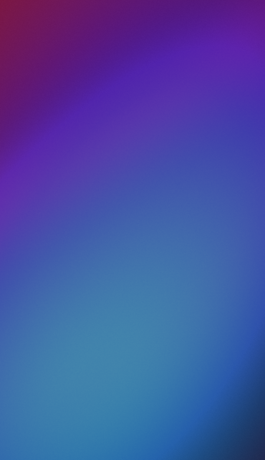

# Liquid Glass (AGSL) en Cypher Android — especificación del estado actual

Documento de análisis. No se ha modificado código, autenticación, base de datos ni
reproducción. Sin commits, tags ni publicaciones.

Fecha: 16 de noviembre de 2026 · Base: `fcab005` + árbol de trabajo de la FASE B.

---

## 0. Resumen: qué existe realmente hoy

Hay que decirlo antes que nada, porque cambia el plan:

| Pieza | Estado real |
| --- | --- |
| Shader AGSL `AGSL_LIQUID_GLASS` | **Existe y se usa**. Es un **fondo ambiental animado**: una malla de tres núcleos de color (metaballs) con dispersión cromática y grano. |
| "Liquid Glass" como superficie de cristal | **No existe**. Los modificadores `liquidGlass`, `liquidGlassFloating` y `realLiquidGlass` pintan una tarjeta **opaca** `#18181B` con borde `#27272A`, y además **no se llama a ninguno desde ninguna pantalla**. |
| Desenfoque del fondo (blur) | **No existe** en ninguna parte de la app. No hay `Modifier.blur`, ni `RenderEffect`, ni captura del fondo. |
| Refracción / distorsión óptica del fondo | **No existe**. El único "refractivo" es un desplazamiento del *patrón interno* del shader, no del contenido de detrás. |
| Reflejos, brillos y bordes luminosos | **No existen** salvo el borde plano de 1 dp de las tarjetas. |
| Código muerto | `RealLiquidGlass.kt` entero y los dos modificadores de `LiquidGlass.kt`. |

Los propios comentarios del código lo confirman:

- `LiquidGlass.kt`: «High-performance solid surface modifier (**Anti-Glassmorphism** container)».
- `RealLiquidGlass.kt`: «Solid Surface Modifier - **Completely eliminates AGSL runtime shaders, optical refractions, and translucent blurs**».

La etiqueta de Ajustes lo llama «Shader **AGSL** Liquid Glass» (`SettingsScreen.kt:1091`).
«ASG» es la grafía invertida de **AGSL** (*Android Graphics Shading Language*).

Consecuencia práctica: no se puede "conservar y perfeccionar" una refracción que no
está implementada. Lo que sí se puede conservar tal cual es el **fondo ambiental AGSL**,
que es la identidad visual actual del reproductor, y construir sobre él el cristal
refractante que falta.

---

## 1. Arquitectura del shader

```
LiquidGlassConfig (DataStore vía ThemePreferences)
        │  colorMode, customColor1..3, animationSpeed, distortionScale, overallOpacity, isEnabled
        ▼
LiquidGlassBackground(config, dynamicColors)
        │
        ├── isEnabled == false  ó  overallOpacity <= 0.01  ──▶  Box(#0D0B11)  (sin shader)
        ├── LocalReducedMotion  ─────────────────────────────▶  StaticLiquidGlassRenderer
        │                                                        (3 radial gradients, sin animación)
        ├── SDK_INT < 33  ───────────────────────────────────▶  LegacyLiquidGlassRenderer
        │                                                        (3 radial gradients que derivan)
        └── SDK_INT >= 33  ──────────────────────────────────▶  AgslLiquidGlassRenderer
                                                                 │
                                    remember { RuntimeShader(AGSL_LIQUID_GLASS) }
                                                                 │
                                    drawWithCache { setFloatUniform(...) × 8 }
                                                                 │
                                    ShaderBrush(shader) ──▶ drawRect() sobre #0D0B11
```

Detalles de la cadena:

1. **Paleta.** En `DYNAMIC` se usan los tres colores extraídos de la carátula
   (`AmbientArtworkColors`: `dominant`, `secondary`, `accent`). En `CUSTOM` se usan
   `customColor1..3` del usuario. El `Triple` se memoriza por modo y colores.
2. **Tiempo.** `rememberInfiniteTransition` → `animateFloat(0f → 1000f, tween(100_000 ms,
   LinearEasing), Restart)`. El shader recibe ese valor como `iTime`; dentro multiplica
   por `iSpeed * 0.32`, así que el barrido completo dura ~100 s a velocidad 1.0.
3. **Dibujo.** `Modifier.drawWithCache` fija los 8 uniforms y construye un
   `ShaderBrush` que se pinta con `drawRect`. El `RuntimeShader` se crea una sola vez
   (`remember`).
4. **Composición.** El shader devuelve `half4(col, iOpacity)`: el color se compone
   sobre `IosDarkBackground` (`#0D0B11`) con esa alfa. No lee nada de la pantalla.

### Uniforms

| Uniform | Tipo | Origen | Uso en el shader |
| --- | --- | --- | --- |
| `iResolution` | `float2` | tamaño del Canvas | normaliza `uv`, calcula `aspect` |
| `iTime` | `float` | transición infinita 0→1000 | fase de todos los movimientos |
| `iSpeed` | `float` | `config.animationSpeed` | multiplica el tiempo |
| `iDistortion` | `float` | `config.distortionScale` | amplitud del *warp* y de la dispersión |
| `iOpacity` | `float` | `config.overallOpacity` | alfa de salida |
| `color1` | `half4` | paleta | núcleo dominante (arriba) |
| `color2` | `half4` | paleta | núcleo secundario (abajo derecha) |
| `color3` | `half4` | paleta | acento que teje (abajo) |

### Matemática interna (constantes fijas en el código)

- `p = uv`, `p.x *= aspect`.
- `t = iTime * iSpeed * 0.32`.
- `warpFactor = clamp(iDistortion, 0, 2) * 0.32`; `flow` = suma de dos senos y dos
  cosenos de baja frecuencia; `warpedP = p + flow`.
- Tres núcleos con órbitas elípticas: `c1 = (0.35·aspect, 0.32) + (sin(t·0.52), cos(t·0.42))·0.22`;
  `c2 = (0.68·aspect, 0.68) + (cos(t·0.44), sin(t·0.54))·0.24`;
  `c3 = (0.42·aspect, 0.80) + (sin(t·0.62+1.2), cos(t·0.48+0.9))·0.20`.
- Pesos: `w = smoothstep(radio, 0.05, distancia)` con radios **0.92 / 0.88 / 0.72**
  (el `smoothstep` va invertido: 1 en el centro, 0 en el borde).
- Base `half3(0.05, 0.05, 0.07)`; mezclas con `×0.92`, `×1.25` (núcleo 1),
  `×0.88`, `×1.15` (núcleo 2) y suma `w3 × 0.70` (núcleo 3).
- **Dispersión cromática**: `edge = |w1 − w2|`; `dispersion = smoothstep(0.32, 0, edge) · 0.18 · clamp(iDistortion, 0.1, 2)`;
  suma a R con `color1.r`, a B con `color3.b` y a G con `0.5 · color2.g`.
- **Viñeta**: `smoothstep(1.35, 0.35, length((uv−0.5)·(1.1, 1.25)))`, multiplicando
  entre `0.82` y `1.05`.
- **Grano**: `(fract(sin(dot(fragCoord, (12.9898, 78.233))) · 43758.5453) − 0.5) · 0.022`.

---

## 2. Archivos y componentes implicados

| Archivo | Líneas | Papel |
| --- | --- | --- |
| `app/src/main/kotlin/com/cypher/music/ui/components/LiquidGlass.kt` | 356 | Shader AGSL, `LiquidGlassBackground`, los dos fallbacks, `AmbientMeshBackground` y los modificadores sólidos |
| `app/src/main/kotlin/com/cypher/music/data/LiquidGlassConfig.kt` | 23 | Modelo de configuración y enum `ShaderColorMode` |
| `app/src/main/kotlin/com/cypher/music/data/ThemePreferences.kt` | 20–36, 104–108, 160–167 | Valores por defecto, lectura y escritura en DataStore |
| `app/src/main/kotlin/com/cypher/music/ui/components/CypherNowPlayingModal.kt` | 195–198 | **Uso real 1**: fondo del reproductor a pantalla completa |
| `app/src/main/kotlin/com/cypher/music/ui/components/CypherLyricsSheet.kt` | 185–190 | **Uso real 2**: fondo de la hoja de letras (solo si `showBackground`) |
| `app/src/main/kotlin/com/cypher/music/ui/components/LiquidGlassSettingsSheet.kt` | 738 | Hoja de personalización: modo de color, color picker HSV y tres sliders |
| `app/src/main/kotlin/com/cypher/music/ui/screens/SettingsScreen.kt` | 1073–1096 | Entrada «Shader AGSL Liquid Glass» que abre la hoja |
| `app/src/main/kotlin/com/cypher/music/ui/main/MainViewModel.kt` | 154–156, 609–611 | Expone la config y la persiste |
| `app/src/main/kotlin/com/cypher/music/ui/theme/ReducedMotion.kt` | 7–10 | `LocalReducedMotion`, que desactiva el shader |
| `app/src/main/kotlin/com/cypher/music/ui/components/RealLiquidGlass.kt` | 39 | **Código muerto**: superficie sólida, sin llamadas |

### Dónde se ve de verdad

1. **Now Playing** (`CypherNowPlayingModal`): el shader pinta todo el fondo del modal.
   Si `ambientGlowEnabled` es `false`, se le pasa `overallOpacity = 0f` y queda el
   fondo oscuro plano.
2. **Hoja de letras** (`CypherLyricsSheet`): mismo fondo cuando `showBackground`.
3. **Nada más.** El resto de pantallas (Inicio, Biblioteca, Ajustes, mini player) usan
   superficies Material opacas.

### Código muerto confirmado

`grep` de `.liquidGlass(`, `.liquidGlassFloating(` y `.realLiquidGlass(` en todo
`app/src/main`: **solo aparecen sus definiciones**. Ninguna pantalla los usa.

---

## 3. Parámetros y valores actuales

### Configuración de usuario (`LiquidGlassConfig`)

| Campo | Por defecto | Rango (slider) | Efecto visible |
| --- | --- | --- | --- |
| `colorMode` | `DYNAMIC` | `DYNAMIC` / `CUSTOM` | paleta desde carátula o fija |
| `customColor1` | `#9D7BB0` (lavanda Cypher)¹ | HSV libre | núcleo dominante |
| `customColor2` | `#7A588E`¹ | HSV libre | núcleo secundario |
| `customColor3` | `#352244`¹ | HSV libre | acento |
| `animationSpeed` | `0.60f` | `0.10 … 2.00` | velocidad del flujo |
| `distortionScale` | `0.70f` | `0.00 … 2.00` | deformación de la malla y dispersión |
| `overallOpacity` | `0.65f` | `0.05 … 1.00` | intensidad y alfa del fondo |
| `isEnabled` | `true` | interruptor | apaga el shader por completo |

¹ `LiquidGlassConfig` declara `#FA243C / #651FFF / #00E5FF` (rojo/violeta/cian), pero
`ThemePreferences` construye el objeto con la paleta lavanda, que es la que se aplica
al instalar. Los colores de fábrica del data class solo se ven si alguien crea la
config sin pasar por preferencias.

### Ajustes del tema que afectan al fondo

| Campo | Valor | ¿Se usa? |
| --- | --- | --- |
| `ambientGlowEnabled` | `true` | **Sí**: si es `false`, `overallOpacity` se fuerza a 0 |
| `ambientGlowIntensity` | `0.85f` | **No**: se guarda y se lee, pero nadie lo consume |
| `glassTintAlpha` | `0.05f` | **No**: se guarda y se lee, pero nadie lo consume |

### Lo que el usuario NO puede cambiar

- No hay control de desenfoque (no existe).
- No hay control de refracción sobre el contenido.
- No hay control de reflejos ni de borde luminoso.
- No hay control de radio del *warp* ni de tamaño de los núcleos: solo la amplitud.
- No hay opción de «calidad» (alta/baja): la elección la decide la API del sistema y
  la preferencia de movimiento reducido.

---

## 4. Qué calcula el shader y qué calcula Compose

| Capa | Responsable |
| --- | --- |
| Malla de color, desplazamiento, metaballs, dispersión, viñeta, grano, alfa | **Shader AGSL** (GPU) |
| Tiempo (`iTime`) y su curva | **Compose** (`rememberInfiniteTransition`, `animateFloat`) |
| Tamaño del canvas (`iResolution`) | **Compose** (`drawWithCache`, `size`) |
| Paso de colores a `half4` | **Compose** (`Color.red/green/blue/alpha` → `setFloatUniform`) |
| Fondo base `#0D0B11` | **Compose** (`Modifier.background`) |
| Fallbacks (API < 33, movimiento reducido) | **Compose** (`Brush.radialGradient` × 3 en `drawWithCache`) |
| Bordes, radios, tarjetas, elevación | **Compose** (Material 3) |
| Blur, refracción, reflejos | **Nadie** |

---

## 5. Capturas

**No hay capturas de dispositivo.** No hay teléfono ni emulador disponibles en este
entorno, y no voy a presentar imágenes de otro producto como si fueran de Cypher.

Lo que sí está aquí es la **salida real del algoritmo**: `tools/liquid-glass/render.mjs`
es un port línea a línea del `AGSL_LIQUID_GLASS` (mismos uniforms, mismas constantes,
mismo orden, mismo `smoothstep` invertido) evaluado en CPU y escrito a PNG, compuesto
sobre `#0D0B11` con la misma alfa. También reproduce los dos fallbacks.

| Imagen | Qué muestra |
| --- | --- |
| `capturas/01-shader-lavanda-t12.png` | Paleta lavanda de fábrica, `speed 0.6`, `distortion 0.7`, `opacity 0.65`, `t = 12 s` |
| `capturas/02-shader-paleta-apple-t40.png` | Paleta rojo/violeta/cian (modo dinámico con carátula cálida), `t = 40 s` |
| `capturas/03-shader-opacidad-maxima.png` | Mismo instante que la 01 con `opacity = 1.0` |
| `capturas/04-fallback-api29-32.png` | `LegacyLiquidGlassRenderer`: tres pozos radiales derivando |
| `capturas/05-reduced-motion.png` | `StaticLiquidGlassRenderer`: los mismos pozos, congelados |





Para tener capturas de dispositivo cuando haya uno:

```bash
adb shell screencap -p /sdcard/glass.png && adb pull /sdcard/glass.png
# Now Playing: abre una canción y despliega el modal
# Letras: abre la hoja de letras con el fondo activado
# Ajustes: Ajustes → Shader AGSL Liquid Glass
```

---

## 6. Requisitos gráficos

| Requisito | Valor |
| --- | --- |
| `minSdk` / `targetSdk` | 29 / 36 |
| Camino con shader | **API 33+** (`android.graphics.RuntimeShader`) |
| Camino sin shader | API 29–32: tres radial gradients animados |
| Movimiento reducido | Cualquier API: radial gradients estáticos |
| Backend | AGSL se ejecuta en el pipeline de HWUI (Skia + GPU, GLES/Vulkan). No hay renderizado por software en el camino normal |
| Memoria | Un `RuntimeShader` por composición de fondo; sin texturas ni *offscreen buffers* |
| Permisos | Ninguno |
| Dependencias nuevas | Ninguna |

No hay ninguna variante de «calidad baja» más allá de las dos anteriores: no existe un
interruptor manual ni una detección de GPU débil.

---

## 7. Rendimiento

**No he medido nada en dispositivo**, y no voy a inventar cifras. Lo que sí se puede
afirmar leyendo el código:

- **Coste por píxel**: el shader corre en cada fragmento visible del fondo (~1–2 M
  fragmentos en pantalla completa). Son ~6 senos/cosenos, 3 `length`, varios
  `smoothstep` y un `sin` de grano: barato para una GPU moderna, notable en GPUs de
  gama baja a 120 Hz.
- **Recomposición por fotograma**: `animTime` se lee en el cuerpo del composable, así
  que **toda la función `LiquidGlassBackground` se recompone cada frame** durante los
  ~100 s del ciclo. Además, como el valor cambia, `drawWithCache` se invalida en cada
  recomposición y vuelve a fijar los 8 uniforms. Funciona, pero es el patrón caro.
  Pasar el tiempo por `State` leído dentro del bloque de dibujo (o usar
  `drawWithCache` + `withFrameNanos`) evitaría recomponer.
- **Sin `SaveLayer`**: el shader se pinta como `drawRect` con `ShaderBrush`; no hay
  capas offscreen ni blur (que sí serían caros).
- **Sin medición**: faltaría `JankStats`/Macrobenchmark y un `systrace` en un
  dispositivo de gama baja para saber si el frame se sostiene a 120 Hz.

---

## 8. Limitaciones

1. **No es cristal**: no hay refracción del contenido, ni blur, ni reflejos, ni borde
   luminoso. Es un degradado de malla detrás del contenido.
2. **No hay separación visual del fondo** más allá del alfa: al no desenfocar lo que hay
   detrás, el texto se apoya en un color plano, no en un cristal.
3. **Aislamiento**: el efecto solo vive en Now Playing y en la hoja de letras. El resto
   de la app no lo tiene.
4. **`AmbientMeshBackground`** (`intensity = 0.65f`) sigue existiendo como puente, pero
   nadie lo llama.
5. **Dos ajustes muertos**: `ambientGlowIntensity` y `glassTintAlpha` no hacen nada.
6. **Modificadores muertos**: `liquidGlass`, `liquidGlassFloating`, `realLiquidGlass`.
7. **El grano es fijo en pantalla** (`fragCoord`), no en el espacio de la escena: al
   desplazarse el contenido, la textura "se pega" al cristal. Es sutil (0.022) pero es
   un artefacto si algún día hay que mover el panel.
8. **`iTime` de 0 a 1000 con salto**: `RepeatMode.Restart` provoca un salto de fase al
   reiniciar el ciclo de 100 s (la malla "salta"). Poco visible con `speed 0.6`, pero
   está.
9. **`smoothstep` con `edge0 > edge1`**: funciona en la práctica, pero es comportamiento
   indefinido en la especificación de GLSL; conviene invertirlo explícitamente.

---

## 9. Recomendaciones para reproducir el efecto en Windows

Ordenadas de «más fiel» a «más barato». La buena noticia: **AGSL y SkSL son casi el
mismo lenguaje**, y en Windows la app ya usa Skia (Compose Desktop / Skiko), así que el
shader se puede portar casi literalmente.

### 9.1 Portar el shader (fondo ambiental)

1. El cuerpo del shader se reutiliza tal cual: `half4 main(float2 fragCoord)` es válido
   en SkSL. Cambiar `uniform float2` por `uniform float2` (SkSL admite `float2`) y
   mantener nombres.
2. En Skiko el objeto es `org.jetbrains.skia.RuntimeEffect.makeForShader(sksl)`, y los
   uniforms se pasan con `RuntimeShaderBuilder(effect).uniform("iTime", t)…makeShader()`.
   No existe `setFloatUniform`; el equivalente es el builder.
3. Pintar con `drawIntoCanvas { it.nativeCanvas.drawRect(rect, Paint().apply { shader = s }) }`
   dentro de un `Modifier.drawWithCache`, igual que hoy.
4. Un `iTime` que nunca reinicie: usar `withFrameNanos` y acumular segundos, en vez de
   una transición finita de 100 s. Elimina el salto del punto 8.

### 9.2 El cristal que falta (lo que hay que construir, no portar)

Para que sea cristal y no una tarjeta con blur, hacen falta cuatro capas, en este orden:

1. **Captura del fondo** de la región del panel: `graphicsLayer` + `drawWithCache`
   dibujando el contenido de detrás, o `rememberGraphicsLayer()` y
   `layer.record { backdrop() }`.
2. **Desenfoque** de esa captura con `Modifier.blur(radius, edgeTreatment = TileMode.Clamp)`
   (Compose Desktop lo soporta en Skia; en Android exige API 31+ o un `RenderScript`/
   `RenderEffect`).
3. **Refracción**: un segundo shader SkSL que *muestree* esa captura con un vector de
   desplazamiento derivado de la normal de la lente (distancia al borde redondeado +
   caída suave), más la dispersión cromática ya existente aplicada a las tres muestras
   R/G/B. Es el paso que convierte «blur detrás» en «lente».
4. **Bordes y reflejos**: un `drawWithContent` con un trazo de 1 px cuyo color dependa
   de `iTime`/posición (gradiente angular) y una especular elíptica en la esquina
   superior izquierda, con `BlendMode.Screen`.

Con eso, la misma receta sirve para Android 13+ y para Windows, y las superficies
pueden dejar de ser opacas.

### 9.3 Qué conservar intacto

- La paleta y el modo `DYNAMIC` desde la carátula: es lo que da la identidad.
- Los tres sliders y sus rangos.
- Los dos fallbacks y la regla de movimiento reducido.
- El fondo actual como *capa 0* del cristal, no como sustituto.

---

## 10. Archivos de este entregable

- `docs/liquid-glass/ESPECIFICACION-ASG-ANDROID.md` (este documento)
- `docs/liquid-glass/capturas/*.png` (5 renders del algoritmo)
- `tools/liquid-glass/render.mjs` (port reproducible del shader a CPU; `node tools/liquid-glass/render.mjs`)
